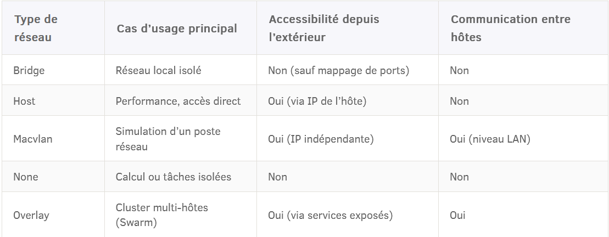
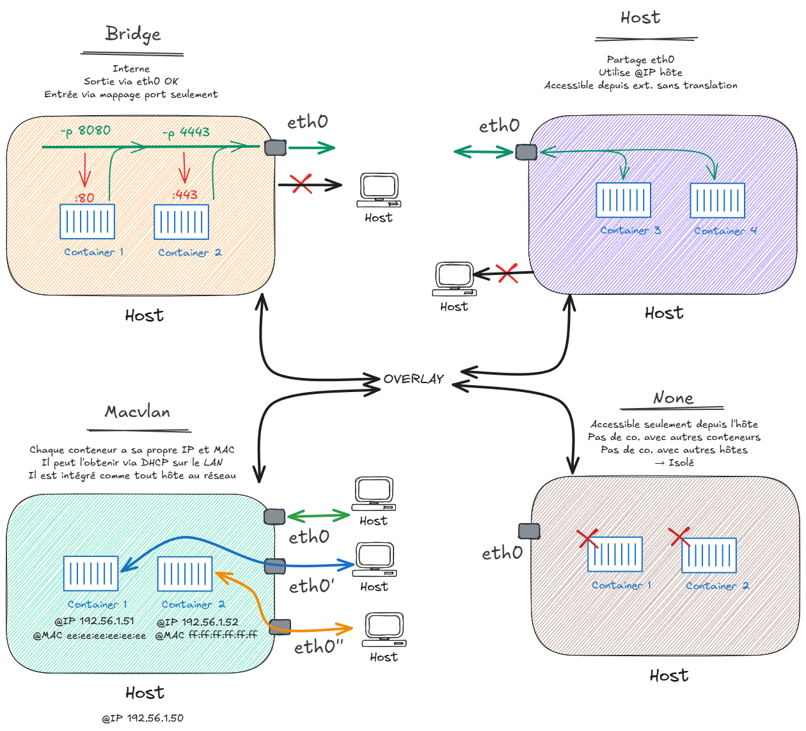
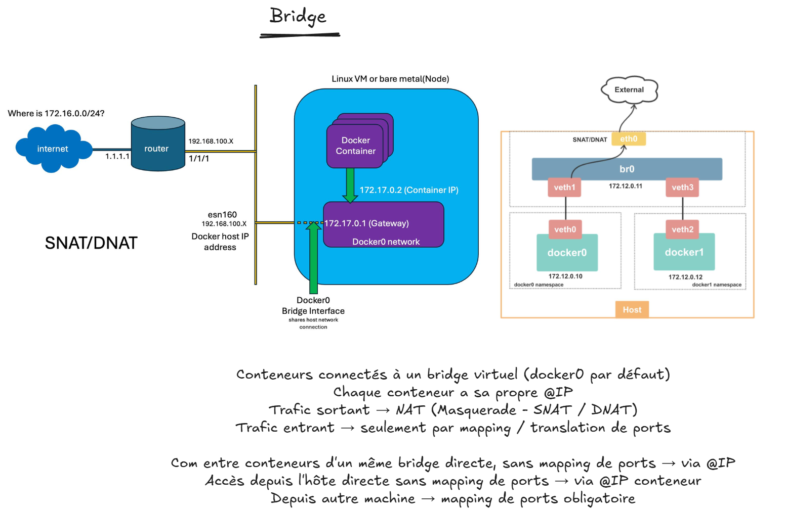
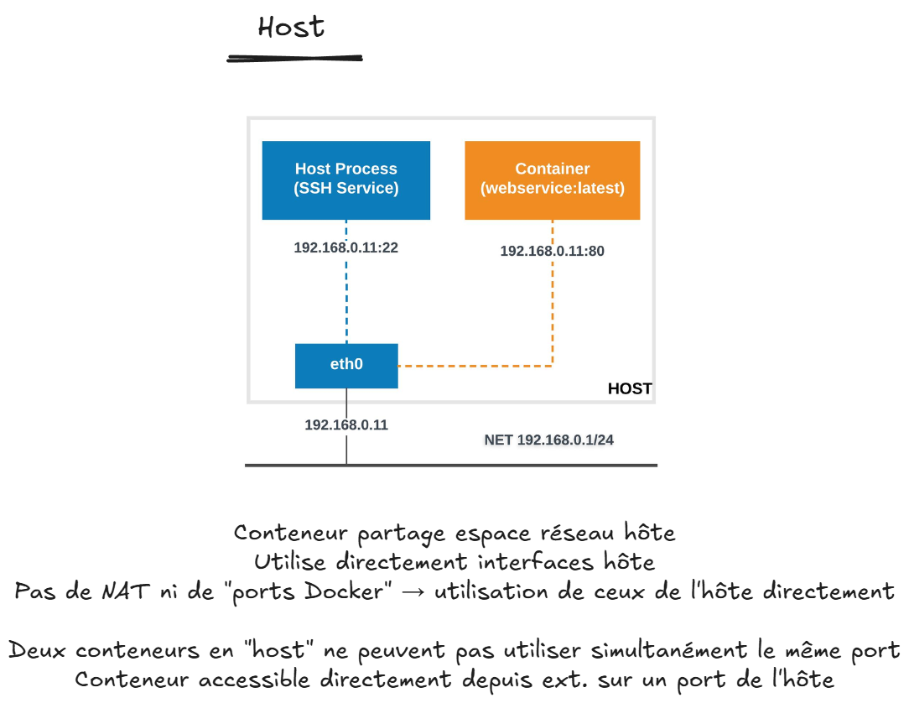
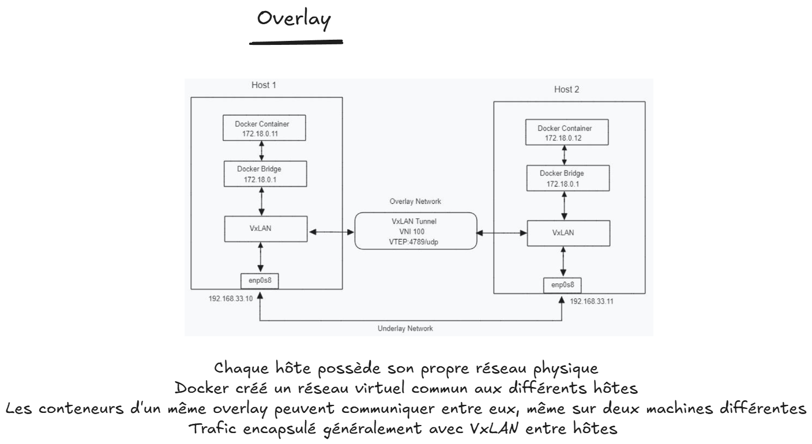

# Networks

> Gèrent la ou les connexions des conteneurs entre eux ou avec l'extérieur

Voici les principaux types de réseaux existants :

---

# Création Dockerfile Net-tools

> Création d'un petit Dockerfile basique pour accueillir et déployer rapidement des outils réseau de base

→ Le coteneur est basé sur Alpine permettant d'étendre un peu plus les fonctionnalités de `busybox` utilisé dans `commands.md`

> [!NOTE]- Astuce surcharge conteneur
>
> On démarre le conteneur avec `CMD` plutôt qu'`ENTRYPOINT` pour permettre la surcharge au démarrage
>
> Avec `CMD ["sleep", "infinity"]` + `docker run --rm net-tools ping 8.8.8.8` → le conteneur exécute directement `ping X.X.X.X`
> Avec `ENTRYPOINT ["sleep", "infinity"]` + `docker run --rm net-tools ping 8.8.8.8` → exécute `sleep infinity ping 8.8.8.8`
> 
> La surcharge ne fonctionnerait pas correctement, la commande de base serait toujours jouée avant

Les outils réseau installés sont les suivants :

`ping`	Tester la connectivité ICMP
`traceroute`	Identifier le chemin réseau
`nslookup`	Tester la résolution DNS
`dig`	Interroger les serveurs DNS
`curl`	Tester les connexions HTTP/HTTPS
`ip addr`	Afficher les interfaces réseau
`ip route`	Afficher la table de routage
`nc`	Tester les connexions TCP/UDP